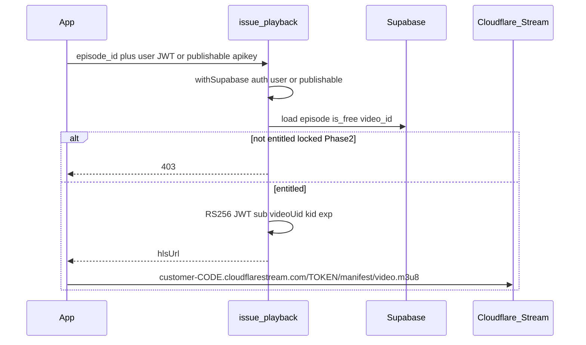

# TuneTalez Phase 2 — Watch Plan

## Approved amendments (locked in)

0. **Video host = Cloudflare Stream (decision change):** Replace Mux. Azonova shared Cloudflare account; single vendor/bill accepted. Provider-agnostic DB column `episodes.video_id` (renamed from `mux_playback_id`). App receives only `{ hlsUrl }`. Provider details live only in `issue-playback` + upload script. Web uses **hls.js** (`Hls.isSupported()` first; native HLS Safari fallback). Stream videos must have `meta.product = "tunetalez"`; never touch others. Signing: mint JWT yourself (RS256, header `kid`, claims `sub`/`kid`/`exp` ≤ 1h) → `https://customer-<CODE>.cloudflarestream.com/<TOKEN>/manifest/video.m3u8`.

1. **`issue-playback` Edge Function auth (new publishable keys):** set `verify_jwt = false` in [`supabase/config.toml`](supabase/config.toml); authorize in code with `@supabase/server` `withSupabase({ auth: ['user', 'publishable'] })` so a **signed-in user JWT** or the **default publishable key** (guests playing free episodes) is accepted. Sources: [Migrating to new API keys](https://supabase.com/docs/guides/getting-started/migrating-to-new-api-keys), [Securing Edge Functions](https://supabase.com/docs/guides/functions/auth), [Function configuration](https://supabase.com/docs/guides/functions/function-configuration), [Authorization headers](https://supabase.com/docs/guides/functions/auth-headers). Exact syntax (confirm again at implement time via Supabase docs MCP):

```toml
[functions.issue-playback]
verify_jwt = false
```

```ts
import { withSupabase } from 'npm:@supabase/server@1'

export default {
  fetch: withSupabase({ auth: ['user', 'publishable'] }, async (req, ctx) => {
    // entitlement + Mux JWT mint; guests OK when episode.is_free
    // ctx.authMode === 'user' | 'publishable'
  }),
}
```

2. **Web player tokens (React API):** `@mux/mux-player-react` uses the React prop `tokens={{ playback, thumbnail, storyboard }}`, **not** the HTML attribute `playback-token`. `issue-playback` mints all three JWTs (`aud` `"v"`, `"t"`, `"s"`; same `sub`/`kid`/RS256) and returns them; native expo-video uses only `playback`. Re-fetch all three on expiry.

3. **Web player:** `expo-video` on web is a plain `<video>` (no hls.js) → HLS fails on Firefox desktop and hits Chrome 141–142 native-HLS bugs. Use **`@mux/mux-player-react` ≥ 3.8** in a **`.web.tsx`** platform file with signed tokens via React prop **`tokens={{ playback, thumbnail, storyboard }}`** (not the HTML `playback-token` attribute); keep **`expo-video` on iOS/Android**. Native uses only the `playback` JWT. Step 6 verify: web plays in **Chrome, Firefox, and Safari**.
4. **Web autoplay:** start **muted** with **tap-to-unmute** (Chrome autoplay policy).
5. **Signed playback URL:** `https://stream.mux.com/{playbackId}.m3u8?token={playbackJwt}`. JWTs **RS256**; claims: `sub` = playback ID, `kid` = signing key ID; mint `aud` `"v"` / `"t"` / `"s"` for playback / thumbnail / storyboard. Private key = base64 as Mux provides. On expiry, re-fetch all three from `issue-playback`.
6. **`episodes.duration_seconds`:** already in Phase 1 schema — do **not** re-add. Upload script **fills/updates** it from Mux asset duration after encode.
7. **Upload:** `video_quality: "basic"`. Staging stays on **Mux Free** (≤ **10** assets total — reuse playback IDs across seed episodes). Add to [`docs/PRODUCTION_CHECKLIST.md`](docs/PRODUCTION_CHECKLIST.md): Mux **production** environment + signing key + **Pay-as-you-go** plan.

## Approved decisions (locked in)

1. **Video host = Cloudflare Stream** (Azonova account; not Mux, not DIY HLS on R2). Rationale in Decision A.
2. **Playback access:** Stream videos use `requireSignedURLs: true` + `meta.product=tunetalez`. Client never stores signing keys. Only `issue-playback` mints short-lived JWTs after entitlement (`episodes.is_free` in Phase 2; unlocks in Phase 3).
3. **Player:** native = `expo-video` (Expo Go OK); web = `hls.js` via `.web.tsx` (`Hls.isSupported()` then native HLS fallback). Preload next 2 on native via detached `VideoPlayer`s.
4. **Progress:** upsert `watch_history` every 5 s; Continue watching + History; add **DELETE** RLS. Likes/share UI-only (Phase 4 for persistence).
5. **Free count:** seed `is_free = (episode_number <= 4)` (PRD §11). Unlock cost display constant **60** coins (no DB column until Phase 3).
6. **Staging video content:** reuse Stream UIDs across 6×10 seed episodes where helpful; tag `meta.product=tunetalez`. Real drama library later (PRD §11 Q6 / Admin).
7. **Cloudflare:** posters stay on `tunetalez-media-staging`. Stream allowed only for `meta.product=tunetalez` videos. No new non-`tunetalez-*` CF resources besides Stream videos so tagged.
8. After you click **Build**, **Step 0** writes this plan to [`docs/PHASE2_PLAN.md`](docs/PHASE2_PLAN.md) before any other work.

## Decision A — Video delivery comparison

| | **Cloudflare Stream (chosen)** | **Mux** | **Self-encoded HLS on R2** |
|---|---|---|---|
| Setup | Upload → auto ABR; `requireSignedURLs` + signing key JWT | Upload → signed playback IDs + JWT | DIY ffmpeg ladder; Worker/HMAC |
| Billing | Same Azonova Cloudflare invoice as R2/Pages (accepted) | Separate Mux account/bill | R2 cheap; eng + ABR ops dominate |
| Product isolation | Tag videos `meta.product=tunetalez`; never touch others | Separate Mux env | Fits `tunetalez-*` R2 naming |
| Signed playback | First-class signed tokens in path | First-class `signed` + query token | Presigned URLs; bad fit for HLS |

**Chosen: Cloudflare Stream.** Single vendor/bill with existing Azonova Cloudflare (R2/Pages). Isolate TuneTalez assets via `meta.product=tunetalez` and `cloudflare-safety.mdc`. Client stays provider-agnostic (`video_id` + `hlsUrl` only).

## Decision B — Locked episodes not playable by URL



- Store **`video_id`** on `episodes` (Stream UID today; not a playable URL).
- Entitlement Phase 2: `is_free === true` (guests via publishable key OK). Locked → **403**.
- Playback URL: `https://customer-<CODE>.cloudflarestream.com/<TOKEN>/manifest/video.m3u8`.
- JWT: **RS256**; header `kid`; claims `sub` = video UID, `kid`, `exp` ≤ 1h. Signing key from `POST /stream/keys` (JWK base64 in Edge secret). On expiry → re-call `issue-playback`.
- Never put Stream signing private key / JWK in `EXPO_PUBLIC_*` or git.

## Decision C — Player

| Topic | Answer |
|---|---|
| Native (iOS/Android) | `expo-video` — **Included in Expo Go**. Source: [expo-video docs](https://docs.expo.dev/versions/latest/sdk/video/). |
| Web | `hls.js` in `EpisodePlayer.web.tsx` (`Hls.isSupported()` then native HLS); native `EpisodePlayer.tsx` keeps expo-video with `hlsUrl`. |
| Web autoplay | **Muted** start + **tap-to-unmute** (Chrome policy). |
| Dev build | Not required for Phase 2 (no background/PiP plugin features). |
| Native HLS | Stream signed `hlsUrl`; `contentType: 'hls'` if needed. |
| Preload next 2 (native) | Up to 3 `VideoPlayer`s (current + next + next+1); buffer without `VideoView`; release off-window; cap on Android. |
| Token refresh | On playback error from expired JWT, re-fetch `hlsUrl` from `issue-playback` and remount player. |

## Decision D — Data / RLS

**Existing (Phase 1):** `episodes.duration_seconds` already exists; `watch_history` select/insert/update own (no delete).

**Phase 2 migration:**
- `episodes.mux_playback_id text null`
- RLS: **`watch_history_delete_own`** + GRANT `delete` to `authenticated`
- Seed: `is_free = (n <= 4)`; `mux_playback_id` + `duration_seconds` filled by upload script from Mux

**Queries (authenticated):**
- **Progress write:** upsert every 5 s; also pause / unmount / episode change.
- **Continue watching:** latest incomplete per series (~95% of `duration_seconds`), order `last_watched_at desc`.
- **History:** one row per series; swipe delete / Clear all.

**Guests:** free playback via publishable key; progress save only when signed in.

## Manual work (you only — listed separately)

1. **Create Mux account** — TuneTalez-only; **staging on Free** (≤10 assets). Do not put OkVevo content there.
2. Mux dashboard: **Access Token** (Video write for upload) + **Signing Key** (key ID + base64 private key once).
3. Supabase staging → Edge Function secrets: `MUX_SIGNING_KEY_ID`, `MUX_SIGNING_PRIVATE_KEY`. Never commit.
4. Optional: Mux upload token in local shell for one-time script — not git / not `EXPO_PUBLIC_*`.
5. Provide **≥1 short vertical 9:16 MP4** (or approve Mux demo files); confirm reuse of ≤10 assets across seed episodes.
6. After Edge Function deploy: confirm reachable from Expo app.
7. GitHub Environment `staging`: no Mux secrets in Expo public env (signing server-side only).
8. **Do not** enable Cloudflare Stream, create non-`tunetalez-*` Workers/buckets, or touch `cdn.tunetalez.com` / OkVevo.
9. **Before production launch (checklist):** Mux **production** environment + signing key + **Pay-as-you-go** (added to PRODUCTION_CHECKLIST in Step 6).

## Hard stop conditions

- Mux account / signing key / Edge secrets missing when implementing playback mint.
- Exceeding **10 Mux assets** on staging Free without upgrading.
- Enabling Stream, touching `okvevo-*`, old R2, or `cdn.tunetalez.com`.
- `supabase link` not staging / accidental production.
- Mux signing private key or API token in client env or git.
- Coin wallet / Razorpay / IAP / real unlock spend (Phase 3).

## Out of scope (Phase 3+)

Coin wallet, Unlock **purchase**, Store, VIP, auto-unlock spend, screen 3.4 purchase, likes persistence, Search, full Home hero, Admin upload UI.

## Pre-flight (readonly baseline)

- `episodes` has `duration_seconds`, `is_free`; no `mux_playback_id`.
- `watch_history` exists; no delete policy; unused by app UI.
- Series page: Free/Locked text only — no play.
- For You = placeholder; no `expo-video` / Mux player; no Edge Functions.
- Seed: free if `n <= 3` → change to `<= 4`.
- Media env = posters via `EXPO_PUBLIC_MEDIA_URL` only.

## Execution method

Before each step: 3–5 line mini-plan, then execute only that block. Smallest working code. Commits on **`staging`**. Push when you ask. Graphify: `graphify update .` after substantive code steps. Re-confirm `@supabase/server` / Mux player APIs via docs MCP at implement time.

---

## Step 0 — Persist plan + TASKS

**Mini-plan:** Write approved plan to docs; extend TASKS for Phase 2 checkboxes.

1. Save this plan as [`docs/PHASE2_PLAN.md`](docs/PHASE2_PLAN.md).
2. Add Phase 2 section to [`TASKS.md`](TASKS.md) (plain-English checkboxes matching DONE criteria).
3. Commit: `docs: add Phase 2 Watch plan`.

**Verify:** file exists; TASKS lists Watch items.

---

## Step 1 — Schema + types (staging only)

**Mini-plan:** `mux_playback_id` + History delete RLS; free count 4; types. `duration_seconds` already exists — no column add.

1. Migration: `episodes.mux_playback_id text`; `watch_history_delete_own` + GRANT delete.
2. [`supabase/seed.sql`](supabase/seed.sql): `is_free = (n <= 4)`.
3. `supabase db push` (staging). CI never seeds.
4. Regenerate [`src/types/database.ts`](src/types/database.ts).
5. Commit: `feat: episodes mux_playback_id and watch_history delete RLS`.

**Verify:** column present; authenticated can delete own watch_history; free eps 1–4.

---

## Step 2 — Mux wiring + Edge Function `issue-playback`

**Mini-plan:** After Manual 1–3: deploy gated token mint; upload ≤10 basic assets; fill `mux_playback_id` + `duration_seconds`.

1. [`supabase/config.toml`](supabase/config.toml): `[functions.issue-playback] verify_jwt = false`.
2. `supabase/functions/issue-playback/`: `withSupabase({ auth: ['user', 'publishable'] })`; body `episode_id`; load episode; if not `is_free` → 403; if no `mux_playback_id` → 404; else mint three Mux JWTs (RS256; same `sub`/`kid`; `aud` `"v"` / `"t"` / `"s"`); return `{ playbackId, tokens: { playback, thumbnail, storyboard }, playbackUrl }` where `playbackUrl = https://stream.mux.com/{playbackId}.m3u8?token={playbackJwt}`. Native uses `tokens.playback` only; web passes full `tokens` to MuxPlayer.
3. Document secret names in [`docs/SETUP.md`](docs/SETUP.md) (names only).
4. Script `scripts/upload-staging-videos.mjs`: create assets with `playback_policies: ["signed"]`, **`video_quality: "basic"`**, ≤10 assets; update staging rows with `mux_playback_id` + `duration_seconds` from Mux asset.
5. Commit function + script (no secrets).

**Verify:** invoke with publishable key for free EP → 200 + playable URL; user JWT also works; locked → 403; URL without token fails.

**Hard stop:** Manual steps 1–3 incomplete.

---

## Step 3 — Player core (3.2) + progress + Episodes sheet (3.3) + Up next (3.5)

**Mini-plan:** Shared player API; native expo-video; fetch token; progress; sheets. Web Mux player lands in Step 5 but share fetch/token-refresh helpers here.

1. `npx expo install expo-video`; add `@mux/mux-player-react` ≥ 3.8 (web).
2. Route e.g. [`src/app/watch/[episodeId].tsx`](src/app/watch/[episodeId].tsx) + `EpisodePlayer.tsx` / helpers for token fetch + refresh on expiry.
3. Native: vertical `VideoView`; swipe next/prev; tap pause; chrome; preload next 2.
4. Progress upsert every 5 s + pause/exit (auth only).
5. Episodes sheet + Up next (5s countdown / finished + 3 similar).
6. Series page: Play EP 1 / Continue EP N; locked → Unlock shell.
7. Commit: `feat: HLS player, progress, episodes sheet, up next`.

**Verify:** Expo Go plays free EP; `watch_history` updates; locked no playback; preload swipe feels instant.

---

## Step 4 — For You (2.2) + Continue watching + History (5.2)

**Mini-plan:** For You feed; Home Continue; History segment.

1. For You: EP1 pager; autoplay; preload next 2; Watch full series; Save; Like/Share UI-only.
2. Home Continue watching rail.
3. My List: Saved | History; swipe remove + Clear all.
4. Commit: `feat: For You feed, continue watching, history`.

**Verify:** For You / Continue / History behaviors under RLS.

---

## Step 5 — Lock UI shell + web series player

**Mini-plan:** Unlock shell; web split; Mux Player `.web.tsx` muted autoplay.

1. Unlock sheet shell (60 coins, placeholder balance, CTAs → Phase 3 message); no payment SDK.
2. Web series layout: player left, details + grid right; lock card; keyboard per PRD §5 F7.
3. `EpisodePlayer.web.tsx`: `@mux/mux-player-react` with `tokens={{ playback, thumbnail, storyboard }}`; **muted autoplay** + tap-to-unmute; re-fetch all three tokens on expiry.
4. Commit: `feat: lock UI shell and web Mux player`.

**Verify:** locked never gets token; web split + keyboard; muted autoplay then unmute.

---

## Step 6 — Docs, graphify, typecheck, staging deploy

**Mini-plan:** SETUP + PRODUCTION_CHECKLIST Mux prod; CI; browser smoke.

1. SETUP: Mux Free staging, Edge secrets, `verify_jwt` note, Expo Go + web player notes.
2. [`docs/PRODUCTION_CHECKLIST.md`](docs/PRODUCTION_CHECKLIST.md): unchecked items — Mux **production** environment, production signing key in Edge secrets, upgrade to **Pay-as-you-go**.
3. `graphify update .`; `npm run typecheck` + `lint`.
4. Deploy staging web; verify free EP plays on **Chrome, Firefox, and Safari**.
5. Commit: `docs: Phase 2 Watch setup and Mux launch checklist`.

**Verify:** typecheck/lint pass; web playback in all three browsers; checklist items present unchecked.

---

## Cursor / docs touchpoints

| File | Action |
|---|---|
| [`docs/PHASE2_PLAN.md`](docs/PHASE2_PLAN.md) | This plan (Step 0) |
| [`TASKS.md`](TASKS.md) | Phase 2 checkboxes |
| [`docs/SETUP.md`](docs/SETUP.md) | Mux + Edge secrets + verify_jwt |
| [`docs/PRODUCTION_CHECKLIST.md`](docs/PRODUCTION_CHECKLIST.md) | Mux prod env + signing key + PAYG |
| [`project-context.mdc`](.cursor/rules/project-context.mdc) | Phase 2 status when DONE |

---

## DONE criteria

1. Free episodes play on **Expo Go** (iOS/Android via expo-video) and **staging web** (Mux Player) with signed tokens.
2. Web free EP plays in **Chrome, Firefox, and Safari**; web autoplay starts muted with tap-to-unmute.
3. Locked episodes: Unlock UI; **Edge Function 403**; no anonymous Mux URL works.
4. `issue-playback` works with **user JWT** and **publishable key** (`verify_jwt = false`).
5. Progress every ~5 s; **Continue watching**; **History** remove + clear.
6. For You EP1 feed with **next-2 preload** (native).
7. Episodes sheet + Up next; web split series layout + lock card shell.
8. Staging ≤10 Mux Free assets, `video_quality: "basic"`; PRODUCTION_CHECKLIST has Mux prod + PAYG items.
9. No payment code/tables; no Cloudflare Stream; typecheck + lint; commits on `staging`.
